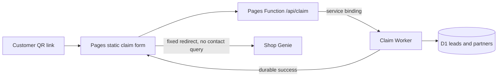
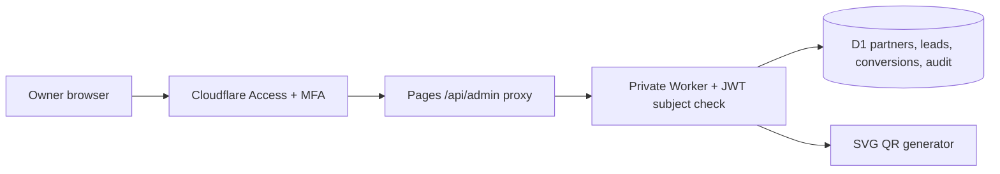
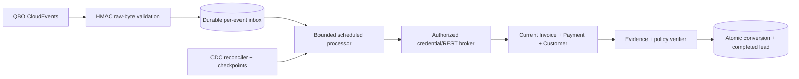

# Architecture

## Implemented first-slice boundary

Buildless HTML/CSS/JS avoids hydration and external fonts/scripts. Pages and API
share an origin through a service binding; browser inputs never choose an API
host or redirect destination. Only customer creation is public. Partner values
and identifiers are resolved by the backend and never returned to customers.
Claim retries use a random request key and canonical payload digest; D1 uniqueness
prevents duplicate lead creation under the same key. Keys bind to payloads.
After a valid QR URL loads, the browser stores its referral in the current history
entry and removes the query string from the visible URL. Sharing the open page
therefore does not carry attribution, while refresh in the same tab still works.
This limits casual link sharing; a photograph or copy of the original printed QR
still carries the referral identifier.

## Owner dashboard (deployed to staging)

The dashboard uses a distinct Access audience and the same exact owner subject.
Partner mutations require same-origin requests, bounded allowlisted fields,
optimistic versions and redacted audit rows. Lead and commission ledgers are
read-only; no dashboard action can create financial evidence, transfer a reward,
or write to QuickBooks. QR assets contain only the public claim URL.

## Sandbox financial integration (deployed and connected)

The core accepts a server-provided reader; no public request can submit an invoice
snapshot as authoritative evidence. Access-protected OAuth, AES-GCM encrypted D1
tokens, durable refresh coordination, signed per-event inbox and scheduled reads
are wired for sandbox only. They fail closed until configured. Recent-invoice
polling supplements notifications; full CDC/backfill is not implemented. The
deployed polling path read a real Sandbox customer, invoice, and payment and
recorded one synthetic reward. Natural token renewal passed repeatedly; genuine
authorized-realm webhook delivery remains unverified. See SANDBOX.md for state/deadline choices and
QUICKBOOKS_SETUP.md for activation.

Required REST reads: invoice by ID, its customer, linked payment records and
payment-to-invoice allocations. A zero balance can result from credits or voids;
it is insufficient alone. Deleted/voided payments, partial cash allocations,
foreign currencies, ambiguous contacts and conflicting data
must not accrue a commission. Refund and later invoice-change policy is open;
production reconciliation must place affected liabilities on hold or reverse
them according to the approved ledger policy. No silent deletion of rewards.

D1 constraints scope invoice uniqueness by provider environment and realm;
the ledger uses integer cents with derived REAL columns for the
requested external schema. Snapshot reward terms at claim time. SQL triggers
complete a lead only when conversion insertion succeeds. No D1 transaction is
assumed to cover an Intuit call. No external financial write exists in this slice.

User-approved policy: all fully paid invoices, fixed first-claim reward, a 30-day
window and one reward per customer. Policy `fox-fixed-first-30-calendar-days-v2`
is enforced by the core and migration 0004. No oil-change filter or tax/percentage
base exists. All claim history participates in attribution; expired/completed
first claims cannot promote a subsequent partner. The latest allocated
Payment.TxnDate must be one of 30 shop-local dates beginning on the claim date.
Same-day payments qualify; webhook arrival and invoice creation are irrelevant.
The Worker resolves the IANA timezone at the claim instant, including DST. D1
rechecks the snapshotted offset/date and day range atomically and binds the
payment date/timezone to retained evidence. D1 does not implement IANA resolution.
New rows store explicit dates, timezone and offset, leaving legacy paid_at null.

Unique customer ID, phone and non-null email indexes supplement invoice/lead
uniqueness for concurrent different invoices. Conflicting identities are held;
email alone does not pick arbitrarily among different phone identities. Legacy
conversion contacts are backfilled from leads; historical customer IDs/payment
times stay unknown, never fabricated. Migration fails on pre-existing duplicate
rewards so an operator can reconcile them without silent history deletion.

## Threat model

Assets: contact PII, referral ownership, reward liabilities, provider grants,
financial evidence. Actors: anonymous customer, malicious claimant/partner,
operator, Intuit, compromised dependency/deployment identity. Boundaries: browser
to Pages/Worker, Worker to D1, future webhook to inbox, credential broker to QBO,
operator identity to connection lifecycle.

| Threat | Mitigation / remaining gap |
| --- | --- |
| SQL/mass assignment/open redirect | Allowlisted fields, prepared statements, fixed destination |
| Contact spoofing/referral fraud | Normalization is not identity proof; no OTP requested; rate controls and business review still needed |
| Claim retries/duplicate invoice events | Stable request digest; invoice/lead uniqueness; atomic insertion/completion |
| Shared email or conflicting phone/email | Reject ambiguous financial matching; no arbitrary first-row match |
| Forged/mixed-realm/replayed webhook | HMAC parser, per-event validation and deployed durable inbox; genuine authorized-realm publication remains unverified |
| Token theft/account swapping/stale refresh | Encrypted context-bound tokens, exact configured realm, operator/session-bound state and confirmation; uncertain renewal is held |
| Stale/revoked job authority | Reader rechecks generation and atomic conversion trigger checks current authority/evidence; already-issued reads have a residual cancellation window |
| Partial persistence/crash | Atomic local constraints; future durable inbox/checkpoint and fault tests required |
| Privileged data theft/supply chain | Least privilege, isolated resources, redaction and independent review still required |

The user owns QBO access and security/release approval; independent review and
operational responder roles remain unassigned (D01-D08). Phone-only matching can
misattribute shared/recycled numbers; absence of a conflict is not identity proof.
No multi-tenant production access, partner login or additional operator is implied.

## Serverless fit and limits

Short stateless claim requests fit Workers; durable state belongs in D1. Avoid
in-memory rate counters/locks and background work after a response as durability.
Proposed financial processing uses bounded scheduled batches with persistent
retry/checkpoint state, no new paid queue requirement. Numeric CPU, request, D1,
QBO quotas and cost/load estimates depend on selected plan/region and are open.
Personal-account staging Pages, Worker and D1 were provisioned with user
authorization; no paid plan or domain was purchased. Sandbox OAuth, renewal and
reconciliation passed; genuine webhook publication and production contracts remain pending.

## Visual plan

An uncluttered automotive service card: white #ffffff, cool gray #eef2f5, navy
#16334a, fox orange #c64b13, slate #526676. A condensed Franklin Gothic display
stack and system sans-serif body keep assets local. Signature: a restrained
oil-drop/service-sticker mark, paired with the exact offer headline; one form,
no dashboard-like tracking details or marketing sections. Mobile first, visible
focus, inline validation, and no animation needed for the single task.
