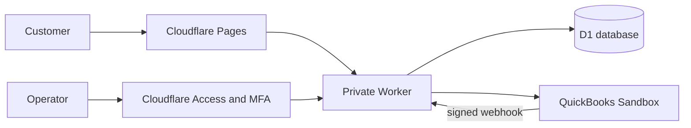

# Staging setup guide

This guide walks a first-time operator through setting up **Fox Referrals** on
Cloudflare and connecting it to a QuickBooks test company. It covers
**staging only** and uses **QuickBooks Sandbox**. Do not connect a live company
while following this guide.

For implementation contracts, diagnostics, and recovery procedures, see
[QUICKBOOKS_SETUP.md](QUICKBOOKS_SETUP.md). Before changing anything, read
[STATUS.md](STATUS.md). Reuse existing resources instead of creating duplicates.

Use this path:

- **Existing staging:** read `STATUS.md`, skip completed sections, and start at
  the first unchecked item.
- **New staging:** begin with the prerequisites and follow every section in order.

Quick navigation: [Cloudflare](#4-prepare-cloudflare) ·
[Access and MFA](#5-protect-operator-routes-with-cloudflare-access) ·
[Intuit](#6-prepare-the-intuit-application) ·
[secrets](#7-store-the-four-worker-secrets) ·
[connect](#8-connect-the-sandbox-company) ·
[end-to-end test](#9-run-the-end-to-end-test) ·
[troubleshooting](#10-common-problems) ·
[checklist](#11-completion-checklist)

## What you will set up



When setup is complete:

- the public claim page can save a lead and open the Fox booking page;
- only the designated operator can manage the QuickBooks connection;
- QuickBooks OAuth tokens are encrypted before they are stored in D1;
- a fully paid Sandbox invoice can create a test commission;
- replaying or rereading the same customer or invoice does not duplicate rewards.

## 1. Learn the identifiers before copying values

Several screens show values that look similar but are not interchangeable.

| Name | Where to find it | Purpose |
| --- | --- | --- |
| Cloudflare Account ID | Cloudflare account overview | Identifies the Cloudflare account |
| D1 Database ID | Output from D1 creation | Binds the Worker to the database |
| Intuit App ID | Intuit app overview | Identifies the app in the portal; **it is not the company ID** |
| Client ID | Keys & Credentials > Development | Identifies the OAuth client |
| Client Secret | Keys & Credentials > Development | Authenticates the OAuth client |
| Company ID / Realm ID | Sandbox companies, under the company name | Identifies the QuickBooks company; use it for `QB_REALM_ID` |
| Webhook verifier | Webhooks > Development | Verifies that a notification came from Intuit |
| Token key | Generated locally by this project | Encrypts OAuth tokens stored in D1 |
| Access AUD | Cloudflare Access application | Identifies the protected Access application |
| Access subject (`sub`) | Authenticated operator identity | Identifies the one allowed operator |

**The Intuit App ID and QuickBooks Company ID are different values.** To find the
Company ID, open **Intuit Developer > My Hub > Sandbox companies** and copy the
number displayed below the company name.

## 2. Credential safety

- Never send a Client Secret, token, OAuth code, cookie, MFA QR code, or MFA code
  through chat, email, screenshots, or issue trackers.
- Paste secrets only into Wrangler's hidden prompt or a Cloudflare field whose
  type is **Secret**.
- Never put secrets in `wrangler.worker.jsonc`, source code, a URL, or documentation.
- `.dev.vars` is local and ignored by Git. Do not show its contents in screenshots.
- Do not replace `QB_TOKEN_KEY` after QuickBooks has been connected. Existing
  encrypted tokens require the original key.
- If a credential is exposed, revoke it at the provider and create a replacement.

## 3. Prerequisites

You need:

- Windows PowerShell;
- Node.js 24.x and npm 11.x;
- a Cloudflare account with Workers, Pages, D1, and Zero Trust;
- an Intuit Developer account;
- an authenticator app for MFA;
- access to the project directory.

Open PowerShell in the project root and run:

```powershell
node --version
npm.cmd --version
npm.cmd ci --ignore-scripts
npm.cmd run check
```

If Windows blocks `npm.ps1`, use `npm.cmd` and `npx.cmd` exactly as shown in this
guide.

## 4. Prepare Cloudflare

### 4.1 Sign in to the correct account

```powershell
npx.cmd wrangler login
npx.cmd wrangler whoami
npx.cmd wrangler d1 list
npx.cmd wrangler pages project list
```

Check the account name and Account ID. If `fox-referrals` and
`fox-referrals-api` already exist, do not recreate them.

### 4.2 Create missing resources only

Run these commands only when the corresponding resource does not exist:

```powershell
npx.cmd wrangler d1 create fox-referrals --config wrangler.worker.jsonc
npx.cmd wrangler pages project create fox-referrals --production-branch main
```

Copy the D1 UUID returned by Wrangler into `database_id` in
`wrangler.worker.jsonc`. Keep `QB_ENABLED` set to `false` until credentials,
Access, and the webhook are ready.

Check these non-secret values in the same file:

| Variable | Staging value or source |
| --- | --- |
| `APP_ENV` | `staging` |
| `PUBLIC_ORIGIN` | `https://fox-referrals.pages.dev` |
| `QB_REDIRECT_URI` | `https://fox-referrals.pages.dev/api/quickbooks/callback` |
| `QB_REALM_ID` | Company ID from the selected Sandbox company |
| `QB_MINOR_VERSION` | `75` |
| `QB_TIME_ZONE` | `America/New_York` for the Maryland shop |

If the Pages project uses a different name, replace the domain everywhere in
this guide, the Cloudflare configuration, and the Intuit application. Do not add
a trailing slash to `PUBLIC_ORIGIN`.

### 4.3 Apply the database and deploy

```powershell
npx.cmd wrangler d1 migrations list fox-referrals --remote --config wrangler.worker.jsonc
npx.cmd wrangler d1 migrations apply fox-referrals --remote --config wrangler.worker.jsonc
npx.cmd wrangler d1 migrations list fox-referrals --remote --config wrangler.worker.jsonc
npx.cmd wrangler deploy --config wrangler.worker.jsonc
npx.cmd wrangler pages deploy public --project-name fox-referrals --branch main
```

The second migration list should contain no pending migrations. The Worker does
not expose a public `workers.dev` endpoint. Pages forwards API requests through a
private service binding.

## 5. Protect operator routes with Cloudflare Access

The customer claim page remains public. Only QuickBooks operator routes require
authentication.

### 5.1 Enable email one-time codes

In the **Cloudflare Zero Trust** dashboard:

1. Open **Settings > Authentication > Login methods**.
2. Enable **One-time PIN**.
3. Use the operator's email address in the policies below.

### 5.2 Create the operator application

For a `pages.dev` hostname, start from the Pages project so Cloudflare creates the
correct application:

1. Open **Workers & Pages > fox-referrals > Settings**.
2. Select **Enable access policy** and then manage the generated application.
3. In **Zero Trust > Access controls > Applications**, configure that application.
4. Change its public hostname from `*.fox-referrals.pages.dev` to
   `fox-referrals.pages.dev` and set the path to `/api/quickbooks/*`.
5. Name it `Fox Referrals Staging`.
6. Set the session duration to 15 minutes.
7. Add an **Allow** policy restricted to the operator's email.
8. Require independent MFA in that policy.

If preview deployments are used, return to the Pages project and enable a separate
preview policy after the main hostname has been narrowed. For a custom domain,
create a **Self-hosted and private** Access application for that domain instead.

Keep `connect`, `callback`, `confirm`, `status`, `pause`, `resume`, and
`disconnect` protected.

### 5.3 Enroll an MFA method

If Cloudflare displays **No authentication methods set up**, select
**Setup MFA**. From the App Launcher, the normal path is
**Account > MFA devices > Add an MFA device**. You can also open:

```text
https://YOUR-TEAM.cloudflareaccess.com/AddMfaDevice
```

Choose **Authenticator application**, scan the QR code with an authenticator app,
enter the generated code, and save. The device name is optional;
`Authenticator` is sufficient. Never share the QR code or generated code.

If Cloudflare shows a **Welcome!** page asking an administrator to enable the
Access App Launcher, enable an App Launcher restricted to the same operator email.
The launcher allows MFA enrollment; the operator application remains separate.

### 5.4 Create the exact webhook bypass

Intuit cannot complete an interactive Access login. Create a second, more specific
Access application for this path only:

```text
fox-referrals.pages.dev/api/quickbooks/webhook
```

Give that application a **Bypass** policy for **Everyone**. Do not use a wildcard
path. The Worker still requires Intuit's valid HMAC signature.

### 5.5 Copy the three Access values

- `ACCESS_TEAM_DOMAIN`: `https://YOUR-TEAM.cloudflareaccess.com`;
- `ACCESS_AUD`: the Audience tag from the operator application;
- `ACCESS_ADMIN_SUB`: the operator's stable `sub`/`user_uuid`, obtained after an
  authenticated request to `/cdn-cgi/access/get-identity`.

Add them to `wrangler.worker.jsonc` and deploy the Worker again.

Verify the route boundaries:

- `/claim?ref=staging-restaurant` opens without Access login;
- `/api/quickbooks/status` requires email OTP and MFA;
- `GET /api/quickbooks/webhook` returns `405`;
- an unsigned `POST /api/quickbooks/webhook` returns `400 INVALID_WEBHOOK`, not an
  Access login page.

## 6. Prepare the Intuit application

### 6.1 Create or select an application

1. Sign in at **developer.intuit.com**.
2. Open **My Hub > Workspaces**.
3. Create or select an app that includes QuickBooks Online accounting access.
4. Use the **Development** tab throughout this guide.

You may reuse an existing development app. Its credentials, redirect URI,
permissions, and webhook must all belong to that same app.

### 6.2 Find the Sandbox company

Open **My Hub > Sandbox companies**. Create a QuickBooks Online Sandbox company if
none exists. Copy the numeric **ID** shown below the company name and set it as
`QB_REALM_ID`. Do not copy the App ID.

### 6.3 Obtain development credentials

Open **Keys & Credentials > Development** and enable **Show credentials**. You
will need the **Client ID** and **Client Secret**. Do not put either value into
the non-secret configuration file.

### 6.4 Configure application URLs

Under **Settings > Development**, enter:

| Field | Value for the current staging hostname |
| --- | --- |
| Host domain | `fox-referrals.pages.dev` |
| Launch URL | `https://fox-referrals.pages.dev/api/quickbooks/status` |
| Disconnect URL | `https://fox-referrals.pages.dev/api/quickbooks/status` |
| Connect/Reconnect URL | `https://fox-referrals.pages.dev/api/quickbooks/connect` |

Under **Redirect URIs > Development**, add exactly:

```text
https://fox-referrals.pages.dev/api/quickbooks/callback
```

A different protocol, extra slash, spelling difference, or different hostname
causes an OAuth redirect error.

### 6.5 Configure the webhook

Under **Webhooks > Development**:

1. Set the endpoint to
   `https://fox-referrals.pages.dev/api/quickbooks/webhook`.
2. Enable **cloud event payload format**.
3. Under **Invoice**, select `created`, `updated`, `deleted`, and `void`.
4. Under **Payment**, select `created`, `updated`, `deleted`, and `void`.
5. Deselect the `emailed` events.
6. Select **Save**.
7. Copy the **Verifier token**. It is not the Client Secret.

## 7. Store the four Worker secrets

Run one command at a time. Paste the requested value only into Wrangler's prompt:

```powershell
npx.cmd wrangler secret put QB_CLIENT_ID --config wrangler.worker.jsonc
npx.cmd wrangler secret put QB_CLIENT_SECRET --config wrangler.worker.jsonc
npx.cmd wrangler secret put QB_WEBHOOK_VERIFIER --config wrangler.worker.jsonc
node scripts/set-token-key.mjs
```

The final command generates and uploads `QB_TOKEN_KEY` without printing it. Then
set `QB_ENABLED` to `true` in `wrangler.worker.jsonc` and deploy:

```powershell
npx.cmd wrangler deploy --config wrangler.worker.jsonc
```

## 8. Connect the Sandbox company

1. Open `https://fox-referrals.pages.dev/api/quickbooks/connect`.
2. Sign in through Cloudflare Access using the allowed email, OTP, and MFA.
3. Select **Authorize sandbox company**.
4. In Intuit, choose the Sandbox company whose ID matches `QB_REALM_ID`.
5. Select **Connect**.
6. After returning, verify the displayed company name and ID.
7. Select **Confirm sandbox company**.

The correct connection status is **active** without **(paused)**. A commission
whose status is `PENDING` is recorded but not yet paid to a partner; it does not
mean that OAuth is pending.

Inspect only safe connection metadata:

```powershell
npx.cmd wrangler d1 execute fox-referrals --remote --config wrangler.worker.jsonc --command "SELECT state,realm_id,paused,token_version,(token_envelope IS NOT NULL) AS has_encrypted_tokens FROM qb_connection WHERE id=1"
```

Expect `active`, `paused=0`, and `has_encrypted_tokens=1`.

## 9. Run the end-to-end test

### 9.1 Create a synthetic partner

```powershell
npx.cmd wrangler d1 execute fox-referrals --remote --config wrangler.worker.jsonc --file seeds/staging.sql
```

Never apply `seeds/local.sql` to a remote database. Never apply the staging seed
to production.

### 9.2 Submit a synthetic claim

Open:

```text
https://fox-referrals.pages.dev/claim?ref=staging-restaurant
```

Enter:

| Field | Synthetic value |
| --- | --- |
| Full name | `Staging Customer 001` |
| Phone | `(202) 555-0162` |

The form accepts US phone numbers only. A Brazilian number is intentionally
rejected. After the lead is saved, the browser opens Fox's real public Shop Genie
booking page. **Stop there and do not create a real appointment.**

### 9.3 Create and pay a Sandbox invoice

1. Open the selected QuickBooks Sandbox company.
2. Select **+ Create > Add customer**.
3. Create `Staging Customer 001` with the same phone. Email may be left blank.
4. Select **+ Create > Invoice**.
5. Choose the customer and add one `Services` line for USD 80.00.
6. Save the invoice without emailing it.
7. Wait a few minutes and verify that no commission exists while it is unpaid.
8. Select **+ Create > Receive payment**.
9. Choose the customer, select `Cash`, and apply the full amount to the invoice.
10. Select **Record and close**.

The Sandbox may apply sales tax and change USD 80.00 to another total, such as
USD 86.40. This does not change the fixed USD 10.00 commission. No real card is
charged during this test.

### 9.4 Verify the result

```powershell
npx.cmd wrangler d1 execute fox-referrals --remote --config wrangler.worker.jsonc --file scripts/verify-staging.sql
```

Expected results:

| Check | Expected |
| --- | --- |
| Connection | `active`, `paused=0`, encrypted tokens present |
| Lead | `COMPLETED` |
| Customer reward count | `1` |
| Commission | `1000` cents with status `PENDING` |
| Environment | `sandbox` |
| Time zone | `America/New_York` |

Intuit states that the first notification can take up to five minutes. An intake
value of `scan` proves that scheduled reconciliation found the invoice.
Only `webhook` proves actual webhook delivery. A payment can be recognized through
the scan even when no real webhook has been observed.

## 10. Common problems

| Symptom | Likely cause | Action |
| --- | --- | --- |
| `No authentication methods set up` | No MFA device has been enrolled | Select Setup MFA or open `/AddMfaDevice` |
| `Welcome!` with no applications | Access App Launcher is disabled | Enable the launcher for the operator email |
| `INVALID_ORIGIN` | A stale form, direct POST, or cached page was used | Reopen `/api/quickbooks/connect` and use its button |
| `QUICKBOOKS_NOT_CONFIGURED` | A required variable or secret is missing | Check the variable names and all four Worker secrets |
| Wrong company or ID error | The App ID was used as the Realm ID | Copy the ID from **Sandbox companies** |
| `refresh_unknown (paused)` | OAuth exchange or refresh ended in an uncertain state | Disconnect the app in the Sandbox company and follow the technical recovery procedure; never edit tokens |
| Fox-auto is absent from integrations | The grant failed before local persistence or was revoked | Fix the cause, then reopen the connect endpoint |
| Claim form rejects the phone | The number is not a US/NANP number | Use `(202) 555-0162` for the synthetic test |
| Shop Genie opens | This is the expected post-claim redirect | Stop there; do not book a real appointment |
| Commission is not immediate | Webhook delivery and cron processing are asynchronous | Wait a few cycles and run `verify-staging.sql` |
| Conversion intake is `scan` | A real webhook was not observed | Check endpoint, bypass, verifier, and subscriptions; do not force database records |

Never troubleshoot by manually changing `token_envelope`, expiration timestamps,
lead status, or conversion rows. Use the operator connection controls and the
technical recovery runbook.

## 11. Completion checklist

- [ ] `npm.cmd run check` passes.
- [ ] The remote migration list has no pending items.
- [ ] The public claim page opens without Access.
- [ ] Operator pages require email OTP and MFA.
- [ ] Only the exact webhook path bypasses interactive login.
- [ ] The Company ID, not the App ID, is stored in `QB_REALM_ID`.
- [ ] All four secrets are stored in the Worker.
- [ ] OAuth reports `active` and `paused=0`.
- [ ] The synthetic lead becomes `COMPLETED`.
- [ ] Exactly one 1000-cent commission exists.
- [ ] Reprocessing does not duplicate the commission.
- [ ] The result is recorded in `docs/STATUS.md` without secrets.

The current staging environment completed the end-to-end flow through scheduled
reconciliation. Real webhook delivery and natural token renewal still need direct
evidence before any production assessment. Read [STATUS.md](STATUS.md) for current
evidence and [OPERATIONS.md](OPERATIONS.md) for production blockers.

## 12. Official references

- [Create a Cloudflare Access application](https://developers.cloudflare.com/learning-paths/clientless-access/access-application/create-access-app/)
- [Cloudflare independent MFA enrollment](https://developers.cloudflare.com/cloudflare-one/access-controls/access-settings/independent-mfa/)
- [Protect a Pages `pages.dev` domain with Access](https://developers.cloudflare.com/pages/platform/known-issues/#enable-access-on-your-pagesdev-domain)
- [Cloudflare D1 Wrangler commands](https://developers.cloudflare.com/d1/wrangler-commands/)
- [Cloudflare Pages service bindings](https://developers.cloudflare.com/pages/functions/bindings/#service-bindings)
- [Intuit webhook configuration](https://static.developer.intuit.com/output_html/qbo/docs/develop/webhooks/configure-webhooks.html)
